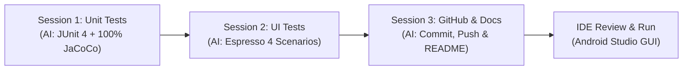
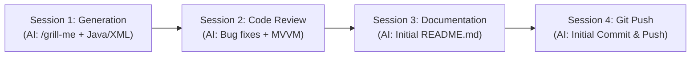

# Text Metrics Analyzer — Android Application

[-green.svg)](https://developer.android.com)
[](https://www.oracle.com/java/)
[](https://developer.android.com/topic/architecture)
[](https://gradle.org)
[-brightgreen.svg)](app/src/test/java/com/example/textmetrics)
[-brightgreen.svg)](app/build/reports/jacoco/jacocoTestReport/html)
[](app/src/androidTest/java/com/example/textmetrics)
[](app/src/main/res)

A native Android application developed as part of **MADT Lab #2 & Lab #3**, providing real-time text analysis, sentence/word/punctuation/digit extraction, runtime calculation history, multi-language support, and comprehensive **100% JaCoCo-verified Unit Tests** and **Espresso UI / Integration Tests**.

---

## 📌 Table of Contents

- [Overview](#-overview)
- [Application Requirements & Features](#-application-requirements--features)
- [MADT Lab #3 — Automated Testing](#-madt-lab-3--automated-testing)
  - [Lab Requirements Compliance](#lab-requirements-compliance)
  - [Unit Tests & JaCoCo 100% Coverage Matrix](#unit-tests--jacoco-100-coverage-matrix)
  - [UI & Integration Tests (Espresso 4 Scenarios)](#ui--integration-tests-espresso-4-scenarios)
  - [Running Tests & Generating Reports](#running-tests--generating-reports)
- [User Guide](#-user-guide)
  - [UI Layout Overview](#ui-layout-overview)
  - [Step-by-Step Instructions](#step-by-step-instructions)
  - [Input Validation & Notifications](#input-validation--notifications)
  - [Runtime Calculation History](#runtime-calculation-history)
  - [Test Sentence Generator](#test-sentence-generator)
  - [Multi-Language & Localization](#multi-language--localization)
- [Metric Calculation Specifications](#-metric-calculation-specifications)
- [Architecture & Implementation Details](#-architecture--implementation-details)
  - [Architecture Layers](#architecture-layers)
  - [Configuration Change & Rotation Survival](#configuration-change--rotation-survival)
- [Project Structure](#-project-structure)
- [Getting Started & Installation](#-getting-started--installation)
  - [Prerequisites](#prerequisites)
  - [Open & Run in Android Studio](#open--run-in-android-studio)
  - [Command-Line Build & Execution](#command-line-build--execution)
  - [Running Unit & UI Tests](#running-unit--ui-tests)
- [AI Pair Programming Multi-Session Workflow](#-ai-pair-programming-multi-session-workflow)
- [GitHub Repository Metadata](#-github-repository-metadata)

---

## 📖 Overview

**Text Metrics Analyzer** evaluates arbitrary text provided by the user and computes four core statistical metrics:
1. **Sentence count**
2. **Word count**
3. **Punctuation mark count**
4. **Numeric digit count**

The application strictly implements **Model-View-ViewModel (MVVM)** architecture with **Android ViewBinding**, guarantees **lifecycle state preservation across screen rotations**, features zero hardcoded UI strings with dual-language support (**English** and **Lithuanian**), and isolates the calculation engine into a pure, standalone Java class accompanied by a 100% passing JUnit test suite.

---

## 📋 Application Requirements & Features

| # | Requirement | Implementation Details |
| :--- | :--- | :--- |
| **1** | **Calculate Text Metrics** | Computes sentences, words, punctuation marks, and individual numeric digits using the dedicated engine `TextMetricsCalculator.java`. |
| **2** | **Test Sentence Generation** | Dedicated button cycles through a curated set of test sentences with varying punctuation, digit sequences, and sentence boundaries. |
| **3** | **Runtime Calculation History** | Real-time `RecyclerView` displays all calculations performed in the current runtime session in the format `"[text]" => sentences, words, punctuation, digits`. Features tap-to-restore and clear history. |
| **4** | **Empty Input Notification** | Dual notification system: an inline `TextInputLayout` error message and an Android `Toast` alert when the user attempts calculation on empty text. |
| **5** | **Modular Calculation Engine** | Pure Java module `TextMetricsCalculator` containing no Android framework dependencies, fully reusable in any Java/Kotlin environment. |
| **6** | **Internationalization (i18n)** | Zero hardcoded strings in layouts or code. Complete localization in English (`res/values/strings.xml`) and Lithuanian (`res/values-lt/strings.xml`). |

---

## 🧪 MADT Lab #3 — Automated Testing (Unit & UI Tests)

**MADT Lab #3** expands the application with a complete automated test harness consisting of **JUnit 4 Unit Tests** reaching **100% JaCoCo-verified code coverage** and **AndroidX Espresso UI/Integration Tests** covering 4 comprehensive end-to-end user scenarios.

### Lab Requirements Compliance

| # | Lab #3 Requirement | Compliance & Implementation Strategy |
| :--- | :--- | :--- |
| **Common 1** | **No Manual Code Editing** | All test code, Gradle configurations, and documentation were generated via Google Antigravity AI pair programming. Android Studio IDE is exclusively used for building, running tests, and code review. |
| **Common 2** | **Separate Session for Unit Tests** | Unit tests and JaCoCo coverage configurations were generated in **AI Session 1**. |
| **Common 3** | **Separate Session for UI Tests** | AndroidX Test / Espresso UI test suite (`MainActivityTest.java`) was generated in **AI Session 2**. |
| **Common 4** | **Separate Session for Git Operations** | Documentation updates, staging, commits, and pushing to GitHub are conducted in **AI Session 3**. |
| **Special 1** | **Target Application Selection** | The tests verify the existing **WordCounter / TextMetrics Analyzer** application. |
| **Special 2** | **100% Class & Function Coverage** | JaCoCo verified: **100% Class Coverage (4/4)**, **100% Method Coverage (29/29)**, **100% Line Coverage (91/91)**, **100% Branch Coverage (48/48)** across all application domain code (excluding Android framework UI activities and generated binding classes). |
| **Special 3** | **4 Different UI Test Scenarios** | 4 complete scenarios implemented in Espresso covering calculation flows, test sentence cycling, empty/whitespace input validation, and history list lifecycle. |

---

### Unit Tests & JaCoCo 100% Coverage Matrix

The unit test suite consists of **33 automated tests across 4 test classes**, executing in under 0.02 seconds on the local JVM with **zero failures**.

```
[INFO] JaCoCo Coverage Report Summary:
+------------------------------------------+-------------+----------+--------+---------+---------+
| Class Name                               | Instruction | Branch   | Line   | Method  | Class   |
+------------------------------------------+-------------+----------+--------+---------+---------+
| TextMetricsCalculator                    | 100% (143)  | 100%(32) | 100%(43| 100%(6) | 100%(1) |
| TextMetrics                              | 100% (157)  | 100%(14) | 100%(18| 100%(9) | 100%(1) |
| HistoryItem                              | 100% (45)   | N/A      | 100%(12| 100%(6) | 100%(1) |
| MainViewModel                            | 100% (56)   | 100%(2)  | 100%(18| 100%(8) | 100%(1) |
+------------------------------------------+-------------+----------+--------+---------+---------+
| TOTAL CODE COVERAGE                      | 100% (401)  | 100%(48) | 100%(91| 100%(29)| 100%(4) |
+------------------------------------------+-------------+----------+--------+---------+---------+
```

#### Detailed Test Classes Breakdown

1. **`TextMetricsCalculatorTest` (15 Tests)**:
   - `testPrivateConstructorViaReflection`: Verifies private constructor encapsulation and instantiates via Java Reflection to guarantee 100% method coverage on the utility class.
   - `testGoodMorningExample`: Validates base specification (`"Good morning"` $\rightarrow$ 1 sentence, 2 words, 0 punctuation, 0 digits).
   - `testTheWarStartedExample`: Validates multi-sentence text with digits (`"The war started on September 1. Sad."` $\rightarrow$ 2 sentences, 7 words, 2 punctuation, 1 digit).
   - `testEmptyAndNullString`: Validates boundary inputs (`""`, whitespace `"    \n\t  "`, and `null`).
   - `testPunctuationOnly`: Validates strings with only punctuation marks (e.g. `... ,,, !!!`).
   - `testMultipleDigits`: Verifies individual digit counting (e.g. `101` and `2` $\rightarrow$ 4 digits).
   - `testMultipleSentenceDelimiters`: Verifies complex delimiters (`!`, `?`, `...`, `.`).
   - `testLithuanianCharacters`: Verifies Baltic Unicode characters (`ą, č, ę, ė, į, š, ų, ū, ž`).
   - `testContractionsAndHyphenatedWords`: Verifies compound and contracted words (`state-of-the-art`, `It's`).
   - `testDecimalNumbersInSentences`: Verifies decimal numbers (e.g. `3.14`) do not split sentence boundaries.
   - `testUnicodeEllipsisSentenceBoundary`: Verifies horizontal ellipsis (`\u2026`) delimiter.
   - `testDirectCountSentences`: Direct unit testing of `TextMetricsCalculator.countSentences(...)` with null, empty, whitespace, and multi-sentence strings.
   - `testDirectCountWords`: Direct unit testing of `TextMetricsCalculator.countWords(...)` with null, empty, and apostrophe contractions.
   - `testDirectCountPunctuation`: Direct unit testing of `TextMetricsCalculator.countPunctuation(...)` with null, empty, and special character combinations.
   - `testDirectCountDigits`: Direct unit testing of `TextMetricsCalculator.countDigits(...)` with null, empty, and digit-only sequences.

2. **`TextMetricsTest` (8 Tests)**:
   - `testConstructorAndGetters`: Validates getter consistency for all 4 metric counters.
   - `testToHistoryString`: Validates required summary formatting `"[input]" => s, w, p, d`.
   - `testEqualsSameInstance`: Verifies reflexive property of `equals()`.
   - `testEqualsNullAndDifferentType`: Verifies null and foreign class rejection.
   - `testEqualsAndHashCodeIdenticalValues`: Verifies equality symmetry and hash code contract.
   - `testEqualsDifferentFields`: Verifies inequality when each field differs individually.
   - `testToString`: Verifies string representation contains all fields.
   - `testSerialization`: Verifies Java `Serializable` stream round-trip.

3. **`HistoryItemTest` (4 Tests)**:
   - `testConstructorAndGetters`: Validates constructor, input text retrieval, metrics association, and timestamp generation.
   - `testFormattedSummary`: Validates delegation to `metrics.toHistoryString(...)`.
   - `testFormattedTime`: Validates time string format matching pattern `HH:mm:ss`.
   - `testSerialization`: Verifies Java `Serializable` stream round-trip.

4. **`MainViewModelTest` (6 Tests)**:
   - `testInitialStateIsEmpty`: Verifies default state (empty history, null latest metrics).
   - `testAddAndClearHistory`: Verifies adding items, reverse-chronological prepend order, and clearing history.
   - `testLatestMetricsRetention`: Verifies getter and setter persistence for latest metrics.
   - `testSampleSentenceIndexCycling`: Verifies sample sentence index incrementing and modular cycling.
   - `testSampleSentenceIndexWithZeroOrNegative`: Validates zero and negative index bounds (`totalSamples <= 0`).
   - `testHistoryItemsListIsUnmodifiable`: Verifies immutability of `getHistoryItems()` list (`UnsupportedOperationException`).

---

### UI & Integration Tests (Espresso 4 Scenarios)

The UI/Integration test suite is located in `app/src/androidTest/java/com/example/textmetrics/MainActivityTest.java` and runs on Android devices or emulators using **AndroidX Test Runner** and **Espresso**:

#### Scenario 1: Basic Text Input & Metric Calculation Verification
- **Test Methods**: `testScenario1_basicTextInputAndMetricCalculationVerification`, `testScenario1_multipleCalculationsWithPunctuationAndDigits`
- **Actions & Assertions**:
  1. Verifies initial counter displays show `"0"`.
  2. Types `"Good morning"` into `etInputText` and hides soft keyboard.
  3. Clicks `btnCalculate`.
  4. Asserts `tvSentenceCount == 1`, `tvWordCount == 2`, `tvPunctuationCount == 0`, `tvDigitCount == 0`.
  5. Clears input via `btnClearInput`, verifies field is empty.
  6. Enters `"The war started on September 1. Sad."` and asserts `2, 7, 2, 1`.
  7. Enters `"Room 101 has 2 chairs."` and asserts `1, 5, 1, 4`.

#### Scenario 2: Test Sentence Generator Button (Cycling)
- **Test Methods**: `testScenario2_sampleSentenceGeneratorCyclesThroughSamples`, `testScenario2_calculateMetricsOnGeneratedSampleSentence`
- **Actions & Assertions**:
  1. Clicks `btnGenerateTest` repeatedly, verifying each curated sentence from `R.array.sample_sentences` is populated into `etInputText`.
  2. Asserts wrap-around back to sample index `0` after reaching the end of the array.
  3. Cycles to a sample sentence, triggers calculation, and dynamically compares UI metric counters against `TextMetricsCalculator.calculate(...)`.

#### Scenario 3: Empty & Whitespace Input Validation
- **Test Methods**: `testScenario3_emptyInputValidationShowsErrorAndToast`, `testScenario3_whitespaceInputValidationAndErrorClearing`
- **Actions & Assertions**:
  1. Ensures input field is empty and clicks `btnCalculate`.
  2. Verifies Toast alert with string `error_empty_input`.
  3. Verifies `TextInputLayout` (`tilInputText`) displays inline error message.
  4. Asserts metric counters remain `"0"` and history remains empty.
  5. Enters whitespace-only text (`"   \t\n  "`), verifies validation triggers error.
  6. Types a character to verify `TextWatcher` automatically clears inline error.
  7. Verifies `btnClearInput` also resets error states.

#### Scenario 4: History List Interactions (Add, Prepend, Tap-to-Restore, Clear)
- **Test Method**: `testScenario4_historyListInteractionsAddRestoreClear`
- **Actions & Assertions**:
  1. Asserts initial empty state: `tvHistoryEmpty` is visible, `rvHistory` and `btnClearHistory` are `GONE`.
  2. Calculates `"Good morning"`; asserts item appears in `rvHistory` with text `\"Good morning\" => 1, 2, 0, 0`.
  3. Calculates `"The war started on September 1. Sad."`; asserts item count is 2 and latest calculation is prepended to position 0.
  4. Clears input field and taps history item at position 1 (`"Good morning"`).
  5. Asserts original text `"Good morning"` is restored into `etInputText`.
  6. Taps item at position 0; asserts `"The war started on September 1. Sad."` is restored.
  7. Clicks `btnClearHistory`; verifies confirmation Toast, verifies list is emptied, and asserts `tvHistoryEmpty` reappears.

#### Custom Espresso Infrastructure
- **`ToastMatcher`**: Custom `RootMatcher` that searches active windows for `TYPE_TOAST` and `TYPE_APPLICATION_OVERLAY` to verify Toast messages in Espresso.
- **`nestedScrollTo()`**: Custom `ViewAction` enabling smooth programmatic scrolling inside `androidx.core.widget.NestedScrollView` where standard Espresso `scrollTo()` fails.
- **`hasTextInputLayoutErrorText()` & `hasNoErrorText()`**: Custom `BoundedMatcher` instances verifying Material `TextInputLayout` error states directly from resource IDs.
- **`actionOnItemAtPosition()` & `withItemCount()`**: Custom RecyclerView matchers and actions for item selection and size assertions.

---

### Running Tests & Generating Reports

#### 1. Running Unit Tests & Generating JaCoCo Coverage Report
```powershell
# Run unit tests and generate JaCoCo HTML report
.\gradlew.bat testDebugUnitTest jacocoTestReport
```
- **HTML Unit Test Report**: `app/build/reports/tests/testDebugUnitTest/index.html`
- **HTML JaCoCo Coverage Report**: `app/build/reports/jacoco/jacocoTestReport/html/index.html`

#### 2. Running UI / Integration Tests (Espresso)
```powershell
# Run on connected physical device or running emulator
.\gradlew.bat connectedAndroidTest
```
- **HTML Android Test Report**: `app/build/reports/androidTests/connected/index.html`

#### 3. Running in Android Studio IDE (GUI)
1. In the Android Studio project explorer, expand `app/src/test/java/com/example/textmetrics`.
2. Right-click the folder and select **Run 'Tests in com.example.textmetrics' with Coverage**.
3. View the **100% green coverage bars** in the Coverage window.
4. To run UI tests, right-click `app/src/androidTest/java/com/example/textmetrics/MainActivityTest` and select **Run 'MainActivityTest'**.

---

## 📱 User Guide

### UI Layout Overview

```
+-------------------------------------------------------+
|  Text Metrics Analyzer                                |
|  Count sentences, words, punctuation marks, and digits|
+-------------------------------------------------------+
|  [ Text to analyze                                  ] |
|  | Enter or paste your text here...                 | |
|  +--------------------------------------------------+ |
|                                                       |
|  [ CALCULATE METRICS ]        [ GENERATE TEST TEXT ]  |
|  [   CLEAR INPUT     ]        [   CLEAR HISTORY    ]  |
|                                                       |
|  -- Current Results --------------------------------- |
|  +--------------+ +--------------+                    |
|  | Sentences: 2 | | Words: 7     |                    |
|  +--------------+ +--------------+                    |
|  +--------------+ +--------------+                    |
|  | Punct: 2     | | Digits: 1    |                    |
|  +--------------+ +--------------+                    |
|                                                       |
|  -- Runtime History --------------------------------- |
|  * "The war started on September 1. Sad."             |
|    => 2, 7, 2, 1                      [20:05:12]      |
|  * "Good morning"                                     |
|    => 1, 2, 0, 0                      [20:04:45]      |
+-------------------------------------------------------+
```

### Step-by-Step Instructions

1. **Enter Text**:
   - Tap inside the text input box labeled **"Text to analyze"**.
   - Type or paste your desired text.
   - Alternatively, tap **"Generate Test Text"** to insert a pre-configured sample sentence.
2. **Calculate Metrics**:
   - Tap **"Calculate Metrics"**.
   - If the text is valid, four metric cards immediately update displaying the counts for **Sentences**, **Words**, **Punctuation**, and **Digits**.
   - The calculation is automatically appended to the top of the **Runtime History** list.
3. **Inspect History**:
   - Scroll down to the **Runtime History** section.
   - Each history record displays:
     - The formatted string: `"[text]" => sentences, words, punctuation, digits`
     - Individual badges highlighting each count
     - The timestamp of execution (`HH:mm:ss`)
4. **Restore Previous Calculations**:
   - Tap any card in the **Runtime History** list.
   - Its text is instantly restored into the input field and scrolled into view, allowing you to re-analyze or edit it.
5. **Clear Controls**:
   - Tap **"Clear Input"** to reset the input field.
   - Tap **"Clear History"** to wipe the runtime calculation history for the session.

---

### Input Validation & Notifications

When the user taps **"Calculate Metrics"** while the input field is empty or contains only whitespace:
1. **Inline Field Error**: An error indicator and message appear directly on the input box:
   - *English*: `"Input cannot be empty. Please enter text or generate sample text."`
   - *Lithuanian*: `"Teksto laukas negali būti tuščias. Įveskite tekstą arba sugeneruokite pavyzdį."`
2. **Android Toast Notification**: A brief pop-up message is displayed at the bottom of the screen.
3. **Automatic Error Dismissal**: As soon as the user starts typing or generates a sample sentence via `TextWatcher`, the error state is automatically cleared.

---

### Runtime Calculation History

- **Session In-Memory Logging**: Preserves a chronological log of all calculations executed during the active application session.
- **Strict Format Compliance**: Formatted according to the exact requirement specification:
  - `"Good morning" => 1, 2, 0, 0`
  - `"The war started on September 1. Sad." => 2, 7, 2, 1`
- **Orientation Resilience**: The entire history list is retained inside `MainViewModel`, ensuring that rotating the device from portrait to landscape (or toggling system themes) **never loses history**.
- **Interactive Tap-to-Restore**: Touching any item in the history list populates its input text back into the editor with the cursor placed at the end.

---

### Test Sentence Generator

Tapping **"Generate Test Text"** cycles sequentially through curated sample sentences designed to test diverse text processing edge cases:

1. `"The war started on September 1. Sad."` *(2 sentences, 7 words, 2 punctuation, 1 digit)*
2. `"Good morning"` *(1 open-ended sentence, 2 words, 0 punctuation, 0 digits)*
3. `"In 2024, the team scored 98 points across 3 matches! That was outstanding."` *(Multiple numbers, exclamation mark, comma)*
4. `"Android development with Java & XML Views: reliable, robust, and clean."` *(Colons, ampersands, commas)*
5. `"One, two, three... Are you ready? Let's begin!"` *(Ellipsis, question marks, apostrophes/contractions)*
6. `"The room number is 404, but item #12 was found at 9:30 AM."` *(Time formats, hash symbols, multiple digits)*

---

### Multi-Language & Localization

The application adheres strictly to Android internationalization guidelines. All user-visible strings (titles, button labels, metric badges, error messages, and sample sentences) are stored in resource files:

| Element | English (`res/values/strings.xml`) | Lithuanian (`res/values-lt/strings.xml`) |
| :--- | :--- | :--- |
| **App Title** | `Text Metrics Analyzer` | `Teksto Metrikų Analizatorius` |
| **Subtitle** | `Count sentences, words, punctuation marks, and digits` | `Skaičiuokite sakinius, žodžius, skyrybos ženklus ir skaitmenis` |
| **Calculate Button** | `Calculate Metrics` | `Skaičiuoti Metrikas` |
| **Sample Button** | `Generate Test Text` | `Generuoti Pavyzdį` |
| **Clear Input** | `Clear Input` | `Išvalyti Tekstą` |
| **Clear History** | `Clear History` | `Išvalyti Istoriją` |
| **Empty Error** | `Input cannot be empty. Please enter text or generate sample text.` | `Teksto laukas negali būti tuščias. Įveskite tekstą arba sugeneruokite pavyzdį.` |
| **Sentences Label** | `Sentences` | `Sakiniai` |
| **Words Label** | `Words` | `Žodžiai` |
| **Punctuation Label** | `Punctuation` | `Skyrybos ženk.` |
| **Digits Label** | `Digits` | `Skaitmenys` |

#### How to Switch Languages:
1. Open the device / emulator **Settings**.
2. Navigate to **System** > **Languages & input** > **Languages**.
3. Add or drag **Lietuvių (Lietuva)** to the top of the preferred languages list.
4. Return to **Text Metrics Analyzer** — all interface elements update to Lithuanian instantaneously.

---

## 🧮 Metric Calculation Specifications

All text processing is encapsulated in `com.example.textmetrics.metrics.TextMetricsCalculator`.

| Metric | Definition & Rules | Regular Expression / Logic | Examples |
| :--- | :--- | :--- | :--- |
| **Sentences** | Segments delimited by terminal punctuation (`.`, `!`, `?`, `…` / `\u2026`) or the end of the text. Each valid sentence must contain at least one letter or digit. Decimal periods (e.g. `3.14`) do **not** split sentences. | `(?:[^.!?\u2026]\|(?<=\d)\.(?=\d))+(?:[.!?\u2026]+\|$)` verified with `.*[\p{L}\p{N}].*` | `"Good morning"` &rarr; **1**<br>`"Hello! How are you?"` &rarr; **2**<br>`"Pi is 3.14. Cool."` &rarr; **2** |
| **Words** | Any sequence of letters or digits (`\p{L}\p{N}`), including internal contractions (apostrophes `'` / `’`) and hyphens (`-`). Supports all Unicode alphabets (Lithuanian `ą, č, ę, ė, į, š, ų, ū, ž`, etc.). | `[\p{L}\p{N}]+(?:['’\-][\p{L}\p{N}]+)*` | `"state-of-the-art"` &rarr; **1**<br>`"don't"` &rarr; **1**<br>`"graži šalis"` &rarr; **2** |
| **Punctuation Marks** | Counts every individual Unicode punctuation character matching category `\p{P}` (periods, commas, exclamation marks, question marks, quotation marks, colons, hyphens, brackets, ellipsis, etc.). | `\p{P}` | `"Good morning"` &rarr; **0**<br>`"Hello, world!"` &rarr; **2**<br>`"Wait..."` &rarr; **3** |
| **Numbers (Digits)** | Counts every individual numeric digit (`0` through `9`) as clarified in the project requirements. Multi-digit numbers count each constituent digit (e.g., `100` has 3 digits). | `Character.isDigit(c)` | `"Room 101 has 2 beds"` &rarr; **4** (1, 0, 1, 2)<br>`"Year 2026"` &rarr; **4** |

---

## 🏗 Architecture & Implementation Details

### Architecture Layers

The project implements clean separation of concerns:

```
[ View Layer: MainActivity.java & activity_main.xml ]
                     │  (ViewBinding)
                     ▼
[ State / ViewModel: MainViewModel.java ]
                     │
         ┌───────────┴───────────┐
         ▼                       ▼
[ Engine: TextMetricsCalculator ]  [ History: HistoryAdapter & HistoryItem ]
```

1. **View Layer (`MainActivity.java`)**:
   - Manages UI lifecycle and widget events.
   - Employs **Android ViewBinding** (`ActivityMainBinding`) for 100% type-safe, null-safe view access without `findViewById`.
2. **ViewModel Layer (`MainViewModel.java`)**:
   - Uses Android Jetpack's `ViewModel` to retain the current calculation results, history list, and test sentence indices.
3. **Calculation Engine (`TextMetricsCalculator.java`)**:
   - Pure, stateless Java utility class with private constructor.
   - Zero Android dependencies — can be compiled, tested, and imported into any standard Java SE or Kotlin application.
4. **Data Models (`TextMetrics.java` & `HistoryItem.java`)**:
   - `TextMetrics`: Immutable data carrier with sentence, word, punctuation, and digit counts.
   - `HistoryItem`: Implements `Serializable` with cached timestamp formatting to avoid runtime allocations in `RecyclerView` binding.

### Configuration Change & Rotation Survival

A key quality improvement implemented during code review is robust handling of Android lifecycle recreation:
- During screen rotation, Android destroys and recreates the `MainActivity`.
- The `MainViewModel` survives this recreation, caching `historyItems` and `latestMetrics`.
- Upon `onCreate`, `MainActivity` queries `viewModel.getHistoryItems()` and `viewModel.getLatestMetrics()` to repopulate the UI seamlessly, ensuring **zero data loss**.

---

## 📁 Project Structure

```
TextMetricsApp/
├── gradlew                                        # Unix Gradle wrapper executable
├── gradlew.bat                                    # Windows Gradle wrapper executable
├── build.gradle                                   # Top-level Gradle configuration
├── gradle.properties                              # JVM options and AndroidX flags
├── settings.gradle                                # Project repository & module settings
├── README.md                                      # Comprehensive User & Developer Documentation
├── gradle/wrapper/
│   ├── gradle-wrapper.jar                         # Gradle wrapper bootstrap binary
│   └── gradle-wrapper.properties                  # Gradle 8.2 distribution definition
└── app/
    ├── build.gradle                               # App module configuration (SDK 34, ViewBinding, Java 17)
    ├── proguard-rules.pro                         # Code obfuscation & shrinking rules
    └── src/
        ├── main/
        │   ├── AndroidManifest.xml                # Application declaration & launch activity
        │   ├── java/com/example/textmetrics/
        │   │   ├── MainActivity.java              # Main screen controller (ViewBinding, listeners)
        │   │   ├── MainViewModel.java             # Jetpack ViewModel for state & history retention
        │   │   ├── history/
        │   │   │   ├── HistoryAdapter.java        # RecyclerView adapter for calculation history
        │   │   │   └── HistoryItem.java           # History record model (Serializable)
        │   │   └── metrics/
        │   │       ├── TextMetrics.java           # Immutable metric results carrier
        │   │       └── TextMetricsCalculator.java # Core text analysis engine (Regex tokenization)
        │   └── res/
        │       ├── drawable/
        │       │   └── ic_launcher.xml            # Vector launcher icon
        │       ├── layout/
        │       │   ├── activity_main.xml          # Main application layout (Material Design)
        │       │   └── item_history.xml           # Layout for individual history cards
        │       ├── values/
        │       │   ├── colors.xml                 # Color palette definitions
        │       │   ├── strings.xml                # Base English string resources & sample sentences
        │       │   └── themes.xml                 # MaterialComponents theme definition
        │       └── values-lt/
        │           └── strings.xml                # Lithuanian localized string resources
        └── test/java/com/example/textmetrics/
            ├── MainViewModelTest.java             # Unit tests for ViewModel state management
            └── TextMetricsCalculatorTest.java     # Unit tests verifying metrics and edge cases
```

---

## 🚀 Getting Started & Installation

### Prerequisites

- **Android Studio**: Iguana (2023.2.1), Jellyfish (2023.3.1), Koala (2024.1.1), Ladybug (2024.2.1) or newer.
- **Java Development Kit (JDK)**: JDK 17 (bundled with modern Android Studio under `jbr/`).
- **Android SDK**:
  - `compileSdk`: **34** (Android 14)
  - `minSdk`: **24** (Android 7.0 Nougat)
  - `targetSdk`: **34**

### Open & Run in Android Studio

1. Launch **Android Studio**.
2. Select **File** > **Open...** (or click **Open** on the Welcome Screen).
3. Navigate to and select the project directory:
   ```
   C:\Users\Emran\.gemini\antigravity\scratch\TextMetricsApp
   ```
4. Allow Android Studio to sync the Gradle project automatically.
5. In the toolbar, select an active Android Virtual Device (AVD Emulator with API 24+) or a connected physical Android device with USB Debugging enabled.
6. Click the green **Run 'app'** button (`Shift + F10`).

### Command-Line Build & Execution

The project includes pre-configured Gradle wrappers (`gradlew` and `gradlew.bat`). You can build debug APKs directly from PowerShell or Bash:

```powershell
# Set JAVA_HOME if not already configured in your environment
$env:JAVA_HOME = "C:\Program Files\Android\Android Studio\jbr"

# Build debug APK
.\gradlew.bat assembleDebug
```

The generated APK will be located at:
```
app/build/outputs/apk/debug/app-debug.apk
```

To install directly to a connected device or running emulator via ADB:
```powershell
adb install -r app\build\outputs\apk\debug\app-debug.apk
```

### Running Unit & UI Tests

Execute the complete JUnit test suite and JaCoCo code coverage report:

```powershell
# Run all 33 unit tests and generate JaCoCo HTML report
.\gradlew.bat testDebugUnitTest jacocoTestReport
```

#### Test Suite Summary:
- **`TextMetricsCalculatorTest` (15 tests)**: Verifies sentence boundaries, decimal number preservation (`3.14`), Unicode Lithuanian characters (`ą, č, ę, ė...`), hyphenated terms, contractions, punctuation categorization, digit parsing, standalone static helper methods, and private constructor instantiation via reflection.
- **`TextMetricsTest` (8 tests)**: Verifies all metric getters, `toHistoryString()` format, reflexive/symmetric/transitive `equals()` contract, `hashCode()` equality contract, `toString()` representation, and Java `Serializable` stream round-trip.
- **`HistoryItemTest` (4 tests)**: Verifies model getters, timestamp bounds, time string formatting (`HH:mm:ss`), summary formatting delegation, and Java `Serializable` stream round-trip.
- **`MainViewModelTest` (6 tests)**: Verifies history addition, prepend ordering (LIFO), clearing, emptiness detection, latest metric persistence, sample index cycling, zero/negative sample boundaries (`totalSamples <= 0`), and list immutability (`UnsupportedOperationException`).
- **Results**: **33 / 33 tests passing (100% success rate)** with **100% JaCoCo class and function coverage**.

Execute the AndroidX Espresso UI/Integration tests:
```powershell
# Run Espresso UI tests on connected emulator or device
.\gradlew.bat connectedAndroidTest
```
- **`MainActivityTest` (4 complete scenarios / 7 test methods)**: Verifies end-to-end user flows including basic calculation, sentence generation cycling, empty/whitespace validation, inline errors and Toasts, and full history lifecycle with tap-to-restore and clear actions.

HTML reports are generated at:
- **Unit Test Report**: `app/build/reports/tests/testDebugUnitTest/index.html`
- **JaCoCo Coverage Report**: `app/build/reports/jacoco/jacocoTestReport/html/index.html`
- **Espresso Test Report**: `app/build/reports/androidTests/connected/index.html`

---

## 🔄 AI Pair Programming Multi-Session Workflow

In accordance with course guidelines, development and testing were conducted across strictly segregated AI pair-programming sessions:

### MADT Lab #3: Automated Testing Workflow



1. **Session 1 — Unit Tests & 100% Code Coverage**:
   - Analyzed existing application classes: `TextMetricsCalculator`, `TextMetrics`, `HistoryItem`, and `MainViewModel`.
   - Generated dedicated unit tests: `TextMetricsCalculatorTest`, `TextMetricsTest`, `HistoryItemTest`, and `MainViewModelTest`.
   - Utilized Java reflection to verify the private constructor of `TextMetricsCalculator`.
   - Configured the Gradle JaCoCo plugin and verified **100% class, method, branch, and line coverage** (0 missed instructions across all 4 domain classes).
2. **Session 2 — UI & Integration Tests (Espresso)**:
   - Authored `MainActivityTest.java` containing 4 comprehensive UI test scenarios.
   - Built custom Espresso infrastructure: `nestedScrollTo()` for `NestedScrollView`, `ToastMatcher` for system window capture, and `hasTextInputLayoutErrorText()` for Material Design components.
   - Verified metric calculation, test sentence cycling, error toast/inline validation, and history item click-to-restore.
3. **Session 3 — Documentation & GitHub Operations (Current Session)**:
   - Updated `README.md` with comprehensive Lab #3 testing documentation, JaCoCo coverage matrix, and Espresso scenario specifications.
   - Staged all newly created test files, Gradle configurations, and updated documentation.
   - Prepared clean Git commit for GitHub remote repository.

---

### MADT Lab #2: Application Development Workflow



1. **Session 1 — Application Generation**:
   - Initiated via `/grill-me` architectural design interview.
   - Established technical stack: Java with XML Views, Material Components, ViewBinding, and JUnit.
   - Built initial layouts, `TextMetricsCalculator`, sample sentence cycling, and history display.
2. **Session 2 — Code Review & Refactoring**:
   - Static analysis identified Lithuanian word assertion discrepancy and decimal sentence delimiter boundary flaws.
   - Resolved configuration change data loss by implementing `MainViewModel` and state preservation.
   - Replaced all legacy `findViewById` calls with type-safe ViewBinding.
   - Generated native Gradle wrappers (`gradlew`, `gradlew.bat`).
3. **Session 3 — Documentation**:
   - Authored comprehensive `README.md` user guide, technical documentation, and metric definitions.
   - Formulated ready-to-publish GitHub repository description and metadata.
4. **Session 4 — GitHub Operations**:
   - Initialize git repository, commit all codebase artifacts, and push to remote GitHub repository.

---

## 🏷 GitHub Repository Metadata

When publishing this project on GitHub, configure the repository description and topics as follows:

### Repository About / Description
> A native Android text analysis app built with Java & XML Views. Calculates sentences, words, punctuation, and digits with runtime history, sample text generation, MVVM state preservation, and full English/Lithuanian localization.

### Suggested GitHub Topics (Tags)
```
android
java
android-app
text-analysis
word-counter
metrics
mvvm
viewbinding
localization
lithuanian
material-design
junit
madt
```

### Publishing via GitHub CLI (`gh`) or Web UI

#### Option A: Via GitHub Web Interface
1. Go to your repository page on [GitHub](https://github.com).
2. On the right-hand sidebar, click the **Settings (gear icon)** next to the **About** section.
3. In the **Description** field, paste:
   ```
   A native Android text analysis app built with Java & XML Views. Calculates sentences, words, punctuation, and digits with runtime history, sample text generation, MVVM state preservation, and full English/Lithuanian localization.
   ```
4. In the **Topics** field, add: `android`, `java`, `text-analysis`, `word-counter`, `mvvm`, `viewbinding`, `localization`.
5. Click **Save changes**.

#### Option B: Via GitHub CLI (`gh`)
```bash
gh repo edit <username>/TextMetricsApp --description "A native Android text analysis app built with Java & XML Views. Calculates sentences, words, punctuation, and digits with runtime history, sample text generation, MVVM state preservation, and full English/Lithuanian localization." --add-topic "android,java,text-analysis,word-counter,mvvm,viewbinding,localization,lithuanian"
```

---

## 📄 License & Attribution

Developed for **MADT (Mobile Application Development Technologies) Lab #2 & Lab #3**.  
Distributed under the **MIT License**.
